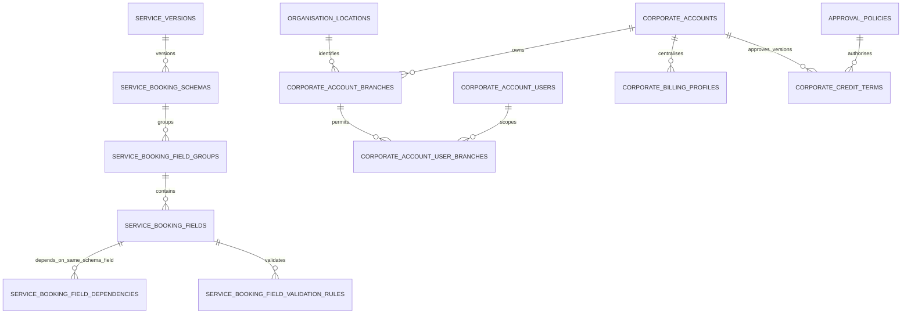

> Combined Increments 5–6 candidate (2026-10-29): 48 migrations / 180 RLS tables (51 public, 129 private), with 577 SQL assertions, 53 concurrency checks and 17 upgrade checks passed. Hosted release gates are pending. See [consolidated report](phase-2-increments-5-6-report.md). Earlier dated entries below are historical.

> Increment 5 local candidate (2026-10-27): six additive migrations, 16 private tables; 32 migrations / 142 RLS tables (51 public, 91 private). Hosted remains at Increment 4: 26 / 126. See [fulfilment report](phase-2-increment-5-report.md), [dictionary](phase-2-increment-5-dictionary.md) and [ERD](phase-2-increment-5-erd.md). No commit/push/deployment or Increment 6 work. Earlier status entries below are historical.

> Hosted checkpoint (2026-10-27): Increment 4 deployed and verified on OnIt, PostgreSQL 17.11: 26 migrations / 126 RLS tables (51 public, 75 private); canonical types updated. [Deployment report](phase-2-increment-4-hosted-deployment-report.md). Increment 5 was not started. Earlier local-only progress entries below are historical.

> Current hosted checkpoint (2026-10-27): Increment 3 deployed and verified on OnIt: 22 migrations, 115 RLS tables (51 public / 64 private), PostgreSQL 17.11. Canonical types updated. See [deployment report](phase-2-increment-3-hosted-deployment-report.md). Increments 4?6 remain unimplemented; earlier status entries below are historical.

# OnIt conceptual ERD

The [Phase 2 implemented request/quotation ERD](phase-2-schema.md#implemented-erd) shows the current local delta. Orders, providers, dispatch and specialised entities below remain planned, not implemented by this increment.

The [Increment 2 pricing/assessment graph](phase-2-increment-2-schema.md#implemented-relationship-graph) extends those shared transactions without separate quotation or order stores.

Proposed principal relationships only. The [inventory](schema-inventory.md) covers supporting entities, junctions and all requirements. Dotted choices such as individual versus organisation ownership require XOR checks; relationships shown here do not grant access.

The [implemented foundation FK graph](foundation-erd.md) is generated separately from actual PostgreSQL catalogs. Later-domain entities shown below remain planned until their migration phases pass the foundation validation gate.

## Implemented Phase 1 refinements

The relationships below are implemented in migrations 008–012 and the generated [physical graph](foundation-erd.md). Pricing mode is a service-version attribute, not a separate price/identity system. Corporate branch scope and department scope both participate in authorization. CMS and delivery relationships remain later-phase design requirements.

## Full-platform conceptual relationships

```mermaid
erDiagram
    AUTH_USERS ||--|| PROFILES : provisions
    PROFILES ||--o{ ORGANISATION_MEMBERS : joins
    ORGANISATIONS ||--o{ ORGANISATION_MEMBERS : contains
    PROFILES ||--o{ USER_ROLE_ASSIGNMENTS : receives
    ROLES ||--o{ USER_ROLE_ASSIGNMENTS : scopes
    ROLES ||--o{ ROLE_PERMISSIONS : bundles
    PERMISSIONS ||--o{ ROLE_PERMISSIONS : grants
    PROFILES o|--o| CUSTOMER_PROFILES : individual_owner
    ORGANISATIONS o|--o| CUSTOMER_PROFILES : corporate_owner
    CUSTOMER_PROFILES ||--o| CORPORATE_ACCOUNTS : extends
    CORPORATE_ACCOUNTS ||--o{ CORPORATE_ACCOUNT_USERS : authorizes
    PROFILES ||--o{ CORPORATE_ACCOUNT_USERS : accesses
    CUSTOMER_PROFILES ||--o{ CUSTOMER_ADDRESSES : saves
    COUNTRIES ||--o{ STATES : contains
    STATES ||--o{ CITIES : contains
    SERVICE_ZONES ||--o{ ZONE_BOUNDARIES_OR_COVERAGE : defines
    SERVICE_AREAS ||--o{ SERVICE_FAMILIES : groups
    SERVICE_FAMILIES ||--o{ SERVICES : contains
    SERVICES ||--o{ SERVICE_VERSIONS : versions
    SERVICE_VERSIONS ||--o{ SERVICE_BOOKING_FIELDS : defines
    CUSTOMER_PROFILES ||--o{ SERVICE_REQUESTS : requests
    SERVICE_VERSIONS ||--o{ SERVICE_REQUESTS : snapshots
    SERVICE_LOCATIONS ||--o{ SERVICE_REQUESTS : locates
    SERVICE_REQUESTS ||--o{ REQUEST_ANSWERS : captures
    SERVICE_REQUESTS ||--o{ SITE_ASSESSMENTS : may_require
    SERVICE_REQUESTS ||--o{ QUOTATIONS : scopes
    QUOTATIONS ||--o{ QUOTATION_VERSIONS : versions
    QUOTATION_VERSIONS ||--o{ QUOTATION_LINE_ITEMS : prices
    QUOTATION_VERSIONS ||--o{ QUOTATION_APPROVALS : approves
    APPROVAL_REQUESTS ||--o{ APPROVAL_STEPS : routes
    APPROVAL_REQUESTS ||--o{ QUOTATION_APPROVALS : records
    QUOTATION_VERSIONS ||--o{ ORDERS : accepted_into
    CUSTOMER_PROFILES ||--o{ ORDERS : owns
    ORDERS ||--o{ ORDER_ITEMS : contains
    ORDER_ITEMS ||--o{ ORDER_WORK_PACKAGES : scopes
    ORDER_WORK_PACKAGES ||--o{ DISPATCH_REQUESTS : dispatches
    DISPATCH_REQUESTS ||--o{ DISPATCH_CANDIDATES : scores
    PROVIDER_PROFILES ||--o{ PROVIDER_MEMBERS : authorizes
    PROFILES ||--o{ PROVIDER_MEMBERS : accesses
    PROVIDER_PROFILES ||--o{ PROVIDER_SERVICE_ELIGIBILITY : qualifies
    PROVIDER_PROFILES ||--o{ ASSIGNMENT_OFFERS : receives
    DISPATCH_REQUESTS ||--o{ ASSIGNMENT_OFFERS : offers
    ASSIGNMENT_OFFERS ||--o| ASSIGNMENTS : accepts
    ORDER_WORK_PACKAGES ||--o{ ASSIGNMENTS : reassigned_over_time
    ASSIGNMENTS ||--o{ SERVICE_EXECUTION_STEPS : executes
    ASSIGNMENTS ||--o{ QUALITY_INSPECTIONS : independently_inspected
    QUALITY_INSPECTIONS ||--o{ QUALITY_FINDINGS : finds
    QUALITY_INSPECTIONS ||--o{ QUALITY_DECISIONS : decides
    QUALITY_DECISIONS ||--o{ REWORK_REQUESTS : may_require
    ORDERS ||--o{ LOGISTICS_JOBS : moves
    LOGISTICS_JOBS ||--o{ CUSTODY_TRANSFERS : tracks
    LOGISTICS_JOBS ||--o{ DELIVERY_PROOFS : proves
    ORDERS ||--o| LAUNDRY_ORDERS : specializes
    LAUNDRY_ORDERS ||--o{ LAUNDRY_BAGS : identifies
    LAUNDRY_ORDERS ||--o{ LAUNDRY_ORDER_ITEMS : counts
    LAUNDRY_PROCESSING_BATCHES ||--o{ LAUNDRY_BATCH_ITEMS : allocates
    LAUNDRY_ORDER_ITEMS ||--o{ LAUNDRY_BATCH_ITEMS : processes
    CUSTOMER_PROFILES ||--o{ CLIENT_ENGAGEMENTS : commissions
    CLIENT_ENGAGEMENTS ||--o{ SERVICE_CONTRACTS : governs
    CLIENT_ENGAGEMENTS ||--o{ CONSTRUCTION_PROJECTS : commissions
    CONSTRUCTION_PROJECTS ||--o{ PROJECT_PHASES : configures
    CONSTRUCTION_PROJECTS ||--o{ PROJECT_VARIATIONS : changes
    CLIENT_ENGAGEMENTS ||--o{ FIELD_CAMPAIGNS : contains
    FIELD_CAMPAIGNS ||--o{ FIELD_TERRITORIES : covers
    FIELD_CAMPAIGNS ||--o{ FIELD_BATCHES : groups
    FIELD_BATCHES ||--o{ FIELD_TASKS : contains
    FIELD_TASKS ||--o{ FIELD_TASK_ASSIGNMENTS : links
    ASSIGNMENTS ||--o{ FIELD_TASK_ASSIGNMENTS : controls
    FIELD_TASKS ||--o{ FIELD_SUBMISSIONS : delivers
    FIELD_FORMS ||--o{ FIELD_FORM_FIELDS : versions
    FIELD_SUBMISSIONS ||--o{ FIELD_SUBMISSION_ANSWERS : answers
    FIELD_SUBMISSIONS ||--o{ FIELD_QA_REVIEWS : verifies
    FIELD_CAMPAIGNS ||--o{ FIELD_CLIENT_APPROVALS : accepts
    ORGANISATIONS ||--o| SUPPLIER_PROFILES : operates
    PROCUREMENT_REQUESTS ||--o{ PROCUREMENT_REQUEST_ITEMS : specifies
    PROCUREMENT_REQUESTS ||--o{ SUPPLIER_QUOTE_REQUESTS : solicits
    SUPPLIER_PROFILES ||--o{ SUPPLIER_QUOTES : submits
    SUPPLIER_QUOTE_REQUESTS ||--o{ SUPPLIER_QUOTES : versions
    SUPPLIER_QUOTES ||--o{ PURCHASE_ORDERS : accepted_into
    PURCHASE_ORDERS ||--o{ GOODS_RECEIPTS : receives
    INVENTORY_MOVEMENTS ||--|{ INVENTORY_MOVEMENT_LINES : records
    INVENTORY_ITEMS ||--o{ INVENTORY_MOVEMENT_LINES : moves
    INVENTORY_LOCATIONS ||--o{ INVENTORY_BALANCES : projects
    INVENTORY_ITEMS ||--o{ INVENTORY_BALANCES : projects
    CUSTOMER_PROFILES ||--o{ INVOICES : billed
    INVOICES ||--|{ INVOICE_LINES : details
    PAYMENT_TRANSACTIONS ||--o{ PAYMENT_ALLOCATIONS : allocates
    INVOICES ||--o{ PAYMENT_ALLOCATIONS : settles
    PAYMENT_WEBHOOK_EVENTS ||--o| PAYMENT_TRANSACTIONS : verifies
    ACCOUNTING_JOURNALS ||--|{ ACCOUNTING_JOURNAL_LINES : balances
    CHART_OF_ACCOUNTS ||--o{ ACCOUNTING_JOURNAL_LINES : posts
    CUSTOMER_PROFILES ||--o{ WALLET_ACCOUNTS : owns
    CHART_OF_ACCOUNTS ||--o{ WALLET_ACCOUNTS : maps
    WALLET_ACCOUNTS ||--o{ WALLET_HOLDS : reserves
    PROFILES ||--o| EMPLOYEE_PROFILES : employed
    EMPLOYEE_PROFILES ||--o{ PAYROLL_ITEMS : earns
    PAYROLL_RUNS ||--o{ PAYROLL_ITEMS : calculates
    APPROVAL_REQUESTS ||--o{ PAYROLL_RUNS : independently_approves
    DOCUMENT_OBJECTS ||--o{ CUSTOMER_DOCUMENTS : links
    DOCUMENT_OBJECTS ||--o{ PROVIDER_DOCUMENTS : protects
    DOCUMENT_OBJECTS ||--o{ FIELD_EVIDENCE : proves
```

The wallet ledger views derive from journal lines; they are deliberately absent as separate writable entities. Payment event intake is many-event-to-one-logical-payment in processing; the conceptual edge denotes a primary verification reference, while unique external transaction IDs prevent multiple postings. The final physical ERD must resolve every declared FK after SQL exists.
