# Implemented foundation FK graph

Generated from actual foundation PostgreSQL foreign keys. Arrows point from child to referenced parent; the data dictionary specifies optionality, composite columns and uniqueness. This is distinct from the [full-platform conceptual ERD](erd.md).

```mermaid
flowchart LR
    private_approval_policies["private.approval_policies"]
    private_approval_requests["private.approval_requests"]
    private_approval_steps["private.approval_steps"]
    private_audit_logs["private.audit_logs"]
    private_corporate_account_user_branches["private.corporate_account_user_branches"]
    private_corporate_account_users["private.corporate_account_users"]
    private_corporate_billing_profiles["private.corporate_billing_profiles"]
    private_corporate_credit_terms["private.corporate_credit_terms"]
    private_customer_notes["private.customer_notes"]
    private_customer_segment_assignments["private.customer_segment_assignments"]
    private_customer_segments["private.customer_segments"]
    private_customer_tag_assignments["private.customer_tag_assignments"]
    private_customer_tags["private.customer_tags"]
    private_departments["private.departments"]
    private_document_objects["private.document_objects"]
    private_employee_profiles["private.employee_profiles"]
    private_lead_activities["private.lead_activities"]
    private_leads["private.leads"]
    private_opportunities["private.opportunities"]
    private_organisation_members["private.organisation_members"]
    private_permissions["private.permissions"]
    private_role_permissions["private.role_permissions"]
    private_roles["private.roles"]
    private_service_availability["private.service_availability"]
    private_service_pricing_rules["private.service_pricing_rules"]
    private_service_rate_cards["private.service_rate_cards"]
    private_system_configurations["private.system_configurations"]
    private_team_members["private.team_members"]
    private_teams["private.teams"]
    private_user_devices["private.user_devices"]
    private_user_role_assignments["private.user_role_assignments"]
    private_user_sessions_metadata["private.user_sessions_metadata"]
    private_zone_boundaries_or_coverage["private.zone_boundaries_or_coverage"]
    private_zone_transport_rates["private.zone_transport_rates"]
    public_activity_events["public.activity_events"]
    public_cities["public.cities"]
    public_city_service_availability["public.city_service_availability"]
    public_communication_preferences["public.communication_preferences"]
    public_corporate_account_branches["public.corporate_account_branches"]
    public_corporate_accounts["public.corporate_accounts"]
    public_countries["public.countries"]
    public_currencies["public.currencies"]
    public_customer_addresses["public.customer_addresses"]
    public_customer_consents["public.customer_consents"]
    public_customer_contacts["public.customer_contacts"]
    public_customer_documents["public.customer_documents"]
    public_customer_feedback["public.customer_feedback"]
    public_customer_profiles["public.customer_profiles"]
    public_local_government_areas["public.local_government_areas"]
    public_notification_preferences["public.notification_preferences"]
    public_organisation_locations["public.organisation_locations"]
    public_organisations["public.organisations"]
    public_profiles["public.profiles"]
    public_service_areas["public.service_areas"]
    public_service_booking_field_dependencies["public.service_booking_field_dependencies"]
    public_service_booking_field_groups["public.service_booking_field_groups"]
    public_service_booking_field_options["public.service_booking_field_options"]
    public_service_booking_field_validation_rules["public.service_booking_field_validation_rules"]
    public_service_booking_fields["public.service_booking_fields"]
    public_service_booking_forms["public.service_booking_forms"]
    public_service_booking_schemas["public.service_booking_schemas"]
    public_service_checklist_items["public.service_checklist_items"]
    public_service_checklists["public.service_checklists"]
    public_service_exclusions["public.service_exclusions"]
    public_service_families["public.service_families"]
    public_service_faqs["public.service_faqs"]
    public_service_locations["public.service_locations"]
    public_service_media["public.service_media"]
    public_service_option_values["public.service_option_values"]
    public_service_options["public.service_options"]
    public_service_requirements["public.service_requirements"]
    public_service_variants["public.service_variants"]
    public_service_versions["public.service_versions"]
    public_service_zones["public.service_zones"]
    public_services["public.services"]
    public_states["public.states"]
    public_support_messages["public.support_messages"]
    public_support_tickets["public.support_tickets"]
    public_user_preferences["public.user_preferences"]
    auth_users["auth.users (Supabase-managed)"]
    private_approval_policies --> public_currencies
    private_approval_policies --> public_organisations
    private_approval_requests --> private_approval_policies
    private_approval_steps --> private_approval_requests
    private_audit_logs --> public_organisations
    private_corporate_account_user_branches --> private_corporate_account_users
    private_corporate_account_user_branches --> public_corporate_account_branches
    private_corporate_account_users --> public_corporate_accounts
    private_corporate_account_users --> private_departments
    private_corporate_account_users --> private_organisation_members
    private_corporate_billing_profiles --> public_customer_contacts
    private_corporate_billing_profiles --> public_corporate_accounts
    private_corporate_credit_terms --> private_approval_requests
    private_corporate_credit_terms --> public_currencies
    private_corporate_credit_terms --> public_corporate_accounts
    private_customer_notes --> public_customer_profiles
    private_customer_segment_assignments --> public_customer_profiles
    private_customer_segment_assignments --> private_customer_segments
    private_customer_tag_assignments --> public_customer_profiles
    private_customer_tag_assignments --> private_customer_tags
    private_departments --> public_organisations
    private_document_objects --> public_customer_profiles
    private_document_objects --> public_organisations
    private_employee_profiles --> public_organisations
    private_lead_activities --> private_leads
    private_leads --> public_customer_profiles
    private_opportunities --> public_currencies
    private_opportunities --> public_customer_profiles
    private_opportunities --> private_leads
    private_organisation_members --> public_organisations
    private_role_permissions --> private_permissions
    private_role_permissions --> private_roles
    private_service_availability --> public_services
    private_service_availability --> public_service_zones
    private_service_pricing_rules --> private_service_rate_cards
    private_service_pricing_rules --> public_currencies
    private_service_pricing_rules --> private_service_rate_cards
    private_service_rate_cards --> public_currencies
    private_service_rate_cards --> public_service_versions
    private_service_rate_cards --> public_service_zones
    private_team_members --> private_organisation_members
    private_team_members --> private_teams
    private_teams --> private_departments
    private_teams --> public_organisations
    private_user_role_assignments --> public_organisations
    private_user_role_assignments --> private_roles
    private_user_role_assignments --> private_teams
    private_user_sessions_metadata --> private_user_devices
    private_zone_boundaries_or_coverage --> public_cities
    private_zone_boundaries_or_coverage --> public_local_government_areas
    private_zone_boundaries_or_coverage --> public_service_zones
    private_zone_transport_rates --> public_currencies
    private_zone_transport_rates --> public_service_zones
    public_cities --> public_states
    public_city_service_availability --> public_cities
    public_city_service_availability --> public_services
    public_communication_preferences --> public_customer_profiles
    public_corporate_account_branches --> public_corporate_accounts
    public_corporate_account_branches --> public_organisation_locations
    public_corporate_accounts --> public_customer_profiles
    public_customer_addresses --> public_cities
    public_customer_addresses --> public_countries
    public_customer_addresses --> public_customer_profiles
    public_customer_addresses --> public_local_government_areas
    public_customer_addresses --> public_states
    public_customer_consents --> public_customer_profiles
    public_customer_contacts --> public_customer_profiles
    public_customer_documents --> public_customer_profiles
    public_customer_documents --> private_document_objects
    public_customer_feedback --> public_customer_profiles
    public_customer_profiles --> public_currencies
    public_customer_profiles --> public_organisations
    public_local_government_areas --> public_states
    public_organisation_locations --> public_cities
    public_organisation_locations --> public_organisations
    public_profiles --> public_profiles
    public_profiles --> auth_users
    public_service_booking_field_dependencies --> public_service_booking_fields
    public_service_booking_field_dependencies --> public_service_booking_fields
    public_service_booking_field_groups --> public_service_booking_schemas
    public_service_booking_field_options --> public_service_booking_fields
    public_service_booking_field_validation_rules --> public_service_booking_fields
    public_service_booking_fields --> public_service_booking_field_groups
    public_service_booking_fields --> public_service_versions
    public_service_booking_forms --> public_services
    public_service_booking_schemas --> public_service_booking_forms
    public_service_booking_schemas --> public_service_versions
    public_service_checklist_items --> public_service_checklists
    public_service_checklists --> public_service_versions
    public_service_exclusions --> public_service_versions
    public_service_families --> public_service_areas
    public_service_faqs --> public_service_versions
    public_service_locations --> public_cities
    public_service_locations --> public_countries
    public_service_locations --> public_customer_profiles
    public_service_locations --> public_customer_addresses
    public_service_locations --> public_states
    public_service_media --> private_document_objects
    public_service_media --> public_service_versions
    public_service_option_values --> public_service_options
    public_service_options --> public_service_versions
    public_service_requirements --> public_service_versions
    public_service_variants --> public_service_versions
    public_service_versions --> public_services
    public_service_zones --> public_states
    public_services --> public_service_families
    public_states --> public_countries
    public_support_messages --> public_support_tickets
    public_support_tickets --> public_customer_profiles
```

Profile/created_by/actor foreign keys are omitted from this graph for readability and are fully enumerated in the dictionary.
