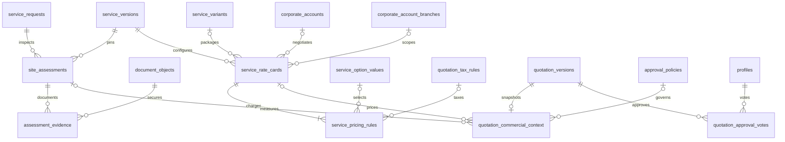

# Increment 2 — schema and security addendum

Local-only delta after Increment 1. No quotation, identity, geography or catalogue table was recreated.

| New private table | Purpose and relationships | Constraints / ownership / lifecycle |
| --- | --- | --- |
| `site_assessments` | Request/account/service-version composite FK; request revision snapshot; numbered assessment revision; remote/physical mode; internal assessor/time slot; checklist/measurement/findings snapshots; maker/completer/approver profile FKs. | Request/revision unique; assessment/account unique; status requires complete scheduling/completion/approval metadata. Different maker/completer/approver. Commands lock request first. Completed content freezes; approved/rejected rows immutable. Retained, no DELETE/TRUNCATE. Scoped staff projections only, no direct client grants. |
| `assessment_evidence` | Exact assessment/account and document/account composite FKs plus creator profile. | One link per assessment/document; append-only. Only assigned assessor can attach during scheduled state. Must be clean, non-archived same-account customer/work document. All raw rows private; Storage checks current scoped permission and exact link. |
| `quotation_commercial_context` | Shared primary key to existing quotation version; rate-card, assessment, internal/customer policy FKs; required vote counts; private cost estimate/completeness; override evidence; immutable configuration/input snapshot; creator profile. | One commercial snapshot per quote version, no mutable parallel quotation. Counts1–20; valid reason for overrides. Append-only. Costs, rule history and policy details excluded from customer DTOs; explicit scoped commercial read RPC only. |
| `quotation_approval_votes` | Existing quotation version, internal/customer side, actor profile and time. | Unique version/side/actor; immutable. Vote permissions and maker/checker/branch checks enforced inside locked decision command. Existing `quotation_decisions` remains the final release/accept/reject event authority. |

All four tables have RLS, revoked anon/authenticated privileges, explicit service-role infrastructure grants and metadata-only audit triggers. No browser/service-role client was added. Internal functions use empty search paths and revoked PUBLIC execution. Public wrappers remain invokers; staff operations use active employment plus explicit scoped permissions. Required FK indexes are added only on tables owned/extended by this candidate.

## Reused tables extended

- `service_rate_cards`: exact variant, customer/branch agreement scope, contract reference, independent approver, minimum service charge/default adjustment tax, percentage discount and internal approval policy. Composite FKs bind variant to service version and branch to customer account. Overlapping approved windows in the same exact scope fail under an advisory lock. Released content remains immutable through the existing guard; retirement only changes status.
- `service_pricing_rules`: customer description, service/labour/material/logistics/other kind, exact catalogue option value, private unit cost, per-rule minimum and tax-rule FK. Existing card/version/currency FKs and released-child guard remain authoritative. One custom-scope rule per card is allowed; no executable expression language is introduced.
- `approval_policies`: internal/customer side, exact corporate account/organisation/branch scope. Existing thresholds/currency, independent-approver requirement, versions and immutable released state are reused. Corporate policies do not confer credit terms.
- `quotation_versions`, `quotation_line_items`: widen monetary amounts to `numeric(20,4)` and add snapshotted `money_scale`0–4, default2 for existing records. Composite version/scale FK prevents line/header mismatch. New arithmetic checks replace only the two old hardcoded two-decimal rounding checks. Existing total/discount/nonnegative/history constraints remain. Unit quantities/prices retain four-decimal precision; financial boundaries round at the stored scale.
- `service_requests`: add a supporting unique request/account/service-version key for assessment composite integrity. No request data is changed.
- `can_read_object`: retain prior customer, branch and public/owner checks; add only clean typed assessment-evidence access for currently authorised staff. No broad staff document policy.

## Workflow/RPC mapping

| Public operation | Purpose |
| --- | --- |
| `create_pricing_card`, `approve_pricing_card`, `read_pricing_card`, `retire_pricing_card` | Draft exact configuration; independent publication; scoped decimal-string configuration view; independent evidenced/idempotent withdrawal. |
| `commercial_policy` | Prepare a quotation threshold policy or independently activate it. No generic arbitrary table writer. |
| `assessment_command`, `read_assessment` | Create idempotent revisions, schedule, link evidence, complete, approve/reject; scoped checklist/evidence read projection. |
| `generate_quotation` | Deterministically choose approved scope and create quote lines/cost/configuration snapshots atomically. |
| Existing `prepare_quotation` | Retain manual custom/assessment scoping where an applicable approved card does not mandate configured preparation. Existing key receipts remain idempotent. |
| Existing `decide_quotation` | Enforce latest approved assessment, current pricing/policy gates, distinct internal/customer votes, override permissions, then invoke the former final transition implementation. Direct authenticated execution of that renamed implementation is revoked. |
| `read_quotation`, `read_quotation_commercial` | Customer-safe exact decimal quotation DTO versus permission-checked internal cost/override/vote DTO. |

New functions do not accept caller-selected actor identity. All transaction-sensitive writes lock the parent request first. Quotation preparation/assessment creation/retirement additionally use actor-scoped idempotency receipts with payload conflict checks. Scheduling serializes on assessor. Final transitions and quote revisions share parent locking to prevent conflicting live versions.

## Implemented relationship graph

Exact column definitions, checks, grants and indexes are in the three ordered [migrations](../../supabase/migrations/20261025000300_pricing_configuration.sql). [Execution report](phase-2-increment-2-report.md) records tests and remaining boundaries.
