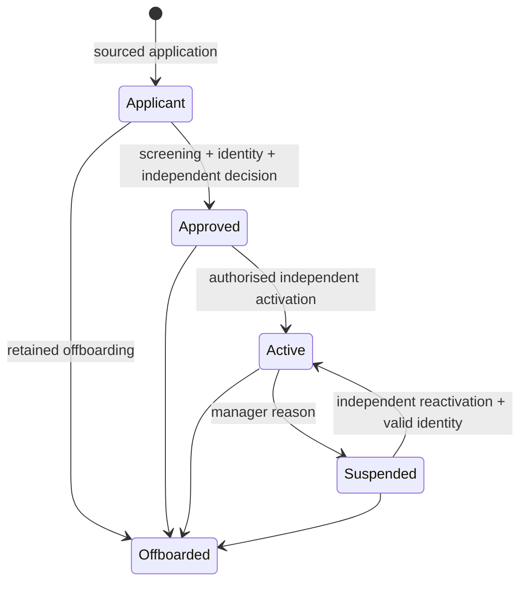

# Increment 3 — provider network implementation checkpoint

Implementation: 2026-10-26–27, Africa/Lagos. **Local implementation only. The Increments 3–6 master assignment is not complete.** This session preserves the working, tested Increment 3 provider-network backend checkpoint, including shared executing-personnel resources. Increments 4, 5 and 6 have not been implemented or started. Runtime/integration limitations remain explicit below; this is not a claim that the full operational backend is complete.

## Verified baseline and boundaries

Git remains on existing `main`, origin `https://github.com/Onitinnovations/Onit.git`, starting at `8ca775e` after implementation checkpoint `97267ee`. No commit, push, branch change, hosted migration, hosted fixture, linked-project change, AWS action or environment change was performed. The unrelated logo remains untouched.

Authorised read-only CLI inspection confirmed OnIt project `utoxjlsvqfmmzsjruzsm`, PostgreSQL **17.11**, exactly the deployed 17 migration versions, 93 tables and no tables without RLS. A complete application-definition comparison against the verified native PostgreSQL baseline matched columns/defaults, constraints, indexes, functions, policies and triggers. All 17 deployed migration hashes and the original Phase 1 seed hash remain unchanged. See [baseline evidence](phase-2-operational-baseline.json).

Reviewed identity/provisioning, organisations/membership/staff permissions, corporate branches, geography, catalogue/forms, pricing/quotes/assessments, document/Storage helpers, audit/approvals, server adapters and test/type tooling. Existing provider organisation classification and Auth profiles were reused; no existing provider-network tables were found. No provider, supplier or employee identity was conflated. The installed Next.js data-security guide was read. Current npm audit returned zero vulnerabilities; no dependency upgrade was needed. No qualifying Next.js feedback issue was observed.

## Exact additive migrations and schema

| File after deployed history | Implemented purpose |
| --- | --- |
| `20261026000100_provider_network.sql` | Seven permission definitions; 20 private tables, UUID/FK/unique/check constraints, RLS, audit, immutable histories and baseline indexes. |
| `20261026000200_provider_commands.sql` | Party ownership, document validation, recruitment/onboarding/personnel/qualifications/training/engagement/capacity/lifecycle commands, optimistic revisions, idempotency receipts and atomic event generation. |
| `20261026000300_provider_eligibility.sql` | Independently approved service/type/zone policies and courses; campaign/session configuration; reasoned eligibility; peak interval capacity accounting; locked reservation/release/expiry; secure read projections and FK indexes. |
| `20261026000400_provider_reads_events.sql` | Dedicated application wrapper, linked provider Storage access, bounded provider/activity/configuration reads, service-worker lease/retry/ack commands and explicit API execution restrictions. |
| `20261026000500_personnel_resources.sql` | Global per-profile human calendars and independently approved versioned capacity; shared cross-business reservations, individual-resource reuse, immutable terms, legacy-helper execution denial and public-wrapper rebinding. |

Local candidate: **22 migrations, 115 application tables (51 public / 64 private), all with RLS**. Hosted remains **17 migrations and 93 tables**. The 22 new tables are not deployed.

| Tables | Responsibility |
| --- | --- |
| `provider_profiles`, `provider_personnel` | Contracting individual/business identity, lifecycle, and explicitly authorised executing personnel/administrators. Personnel have composite same-provider/organisation/membership FKs. No self-granted organisation administration. |
| `provider_recruitment_campaigns`, `provider_applications` | Sourced/referral applications, numbered resubmissions, campaign validity, screenings/interviews and retained stage history through command receipts/events. |
| `provider_qualifications`, `provider_requirement_sets` | Verification/skills/credentials/training, evidence/expiry/independent decisions and effective versioned service/type/zone eligibility requirements. |
| `provider_training_courses`, `provider_training_sessions`, `provider_training_enrolments` | Approved course versions, assigned internal trainer, attendance/results, independent pass/fail and expiring certificates. Certificate-to-enrolment links are provider-consistent. |
| `provider_coverage_areas`, `provider_work_schedules`, `provider_availability` | Exact approved zones, local-time weekday declarations and actual working/leave/blackout windows. No inferred city-wide coverage. |
| `provider_capacity`, `provider_capacity_reservations` | Shared provider/unit resource pools across services, explicit quantities, half-open intervals, expiry-aware peak utilisation, reservation/release. |
| `provider_engagements`, `provider_restrictions`, `provider_performance_events` | Private approved versioned compensation/contract obligations, restrictions and evidenced numerator/denominator observations. No payouts. |
| `provider_history`, `operational_events`, `operational_event_deliveries` | Append-only privileged history, transactional event outbox and separately mutable restricted worker receipts. |
| `provider_personnel_capacity`, `provider_personnel_availability` | Independently approved human resource terms and personal calendars shared across different contracting businesses. These reference existing profiles without creating provider or employee identities. |

All columns, FKs, checks, uniqueness and indexes are catalog-generated in the [dictionary](phase-2-increment-3-dictionary.md). Relationships are in the [FK graph](phase-2-increment-3-erd.md). No duplicate customer, Auth, catalogue, geography, document or approval authority was introduced. Qualification kinds consolidate related evidence instead of creating parallel identity/credential/training certificate stores; course/enrolment provenance remains relational.

## Working workflows and commands

`lib/providers/server.ts` exports server-only `providerOperations(accessToken)`. It validates the caller through Auth `getUser`, sends that caller JWT with the anon key, uses typed mutation/configuration unions and maps database errors to safe application errors. Database commands validate state/authority independently. There is no service-role client, UI or new web endpoint.

- `apply`: idempotent application for an existing Auth profile or authorised organisation. A submitted application creates an applicant, never verified/active status. Trusted internal sourcing requires a recruiter permission. Referral attribution remains a declaration, not proof of a verified referral.
- `change`: screen/interview/reject/resubmit/withdraw; record and independently decide qualifications; approve application; activate/suspend/reactivate/offboard; authorise/revoke personnel; coverage and availability; bounded weekly schedules; pool creation/change; restrictions; versioned engagements; enrol/trainer-assess/independently-confirm training; evidenced performance observations.
- `configure`: requirements/course prepare, independent approve/retire, trainer sessions, recruitment campaign create/close. These are global OnIt configuration permissions and cannot be acquired through an unrelated organisation role.
- `eligibility`: exact service version/zone/window/demand, structured failure reasons, policy/pool/revision IDs and decimal-string capacity/performance projections.
- `reserve` / `release`: staff-controlled idempotent reservation/release/expiry. No provider self-assignment, order or dispatch side effect exists.
- `personnel` / `readPersonnel`: global resource prepare/independent approve/retire and personal calendar declare/revoke/read. Workers may declare their own calendar, but cannot raise/approve their authorised capacity. Company-scoped managers cannot alter global human capacity through an unrelated organisation grant.
- `read`, `list`, `readConfiguration`, `activity`: scoped projections; bounded provider keyset pages and internal history timestamp/UUID keyset pages. Qualifications and upcoming availability are capped at 100 in the summary; they are not a full unlimited archival export.
- `documentReference`: discovers only an authorised clean provider-linked Storage reference; download is still checked by the existing Storage RLS policy. It returns no public/signed bypass URL. Provider training projections include authorised session/attendance/pass/fail state instead of requiring private table access.

Public RPCs: `apply_provider`, `provider_command`, `provider_configuration`, `provider_eligibility`, `provider_reservation`, `read_provider`, `list_providers`, `read_provider_configuration`, `provider_activity`, `provider_document_reference`, `personnel_command`, `read_personnel_resource`. The worker-only `operational_event_worker` is a separate service-role boundary and has no browser adapter.

Application stage and provider status are separate: failed screening rejects the numbered application; a new submission retains the previous attempt. Screening/interview outcomes are retained in immutable command receipts and history rather than replacing the applicant identity. Course enrolment goes `enrolled → assessed → passed/failed`; attendance and score must both satisfy the exact course version. An independent confirmer creates a certificate only on a pass. Reverification/retraining adds new records; it does not rewrite prior decisions.

## Eligibility, coverage and capacity guarantees

Eligibility checks active profile/business/provider, publication of the exact service and its parent classifications, approved effective requirements, identity verification, configured skills/credentials/training and current clean evidence, exact verified zone coverage, working windows and overriding exceptions, restrictions, optional approved contract, configured evidenced performance threshold/window, and available capacity. Missing configuration fails closed. High performance never overrides a failed mandatory condition.

Approved requirement windows cannot overlap for the same service/type/zone. Requirements, course standards and engagement terms freeze once approved. Corrections require new versions. Makers, subjects, provider applicants and current/historical personnel cannot approve their own provider changes. No new operational permission is automatically assigned to a real role or user.

Individual providers use one **shared `concurrent_jobs` pool across services**. Organisation pools use explicitly configured units, allowing processing loads to differ from individual jobs. Pool limits are exact numeric strings at the API boundary. Capacity cannot be disabled/shrunk below a live reservation. Peak usage uses grouped start/end events and a window sum, with simultaneous boundaries merged before summing; it avoids repeated overlap scans and does not sum nonconcurrent jobs. Reservations serialize idempotency receipts; live duplicates converge and competing demands cannot over-allocate the pool. Expired reservations stop consuming capacity even before a worker marks them expired. Assignment conversion belongs to Increment 4 and is not exposed here.

When a human is selected, current membership, qualifications, personal availability and global personal capacity are checked separately from the contracting business. A single selected processing worker consumes one human job slot, not the processing quantity in kilograms. Individual contracting demand uses its explicit job-unit demand. Explicit human capacity is versioned and independently approved; an individual provider's configured `concurrent_jobs` pool/calendar can be reused where no separate human terms exist. Draft/retired human terms never silently fall back to another limit. Human blackout/leave overrides either calendar source. The same profile's reservations are counted across all contracting businesses and individual work.

The lock order is policy → canonical human profile (`FOR NO KEY UPDATE`) → contracting provider → receipt/pool. This serializes competing businesses without creating a FK key-share lock cycle. Multi-connection tests force overlapping transactions and prove only one business reserves a shared worker at capacity one. Legacy party-only helpers are not client-executable; public wrappers are explicitly rebound. Processing-only business eligibility without a selected worker reports `personnel_checked=false`; it is not permission to select an unchecked human. Multi-person order allocation will compose these resources atomically in Increment 4.

Weekday schedules materialise explicit local-zone windows over at most 31 calendar dates, with matching service/provider FKs. Leave/blackout/temporary unavailability override working time. No perpetual recurrence, overnight shift assumption, scheduler or city-wide geocoding promise is invented. Coverage requires an explicit verified zone record. Configured travel limits fail with `trusted_travel_evidence_required` until a trusted distance source exists; no distance or journey time is fabricated.

## Security and event processing

Every new table is in unexposed `private`, RLS-enabled and denied to anon/authenticated table clients. Select/write access is through invoker RPC wrappers and pinned-empty-search-path definer helpers that check current membership, active OnIt employment and scoped permission. Provider users see only their party/authorised worker projection, with no internal compensation projection or staff recruitment history. Unrelated providers and unrelated organisation-scoped staff are denied.

New permission codes: `providers.read`, `providers.documents.read`, `providers.manage`, `providers.approve`, `providers.policy.manage`, `providers.policy.approve`, `providers.capacity.manage`. Identity, staff employment and organisation membership reuse Phase 1. Staff-global configuration is deliberately separate from provider-organisation scope. General provider reads do not grant verification/contract file access. Business administrators cannot read a worker's personal identity document; its owner and separately authorised OnIt document staff retain access.

Storage retains all earlier customer/assessment/marketing rules and adds reads only for exact clean provider-linked qualification/contract documents with current scoped staff or provider authority. HR/customer/other-provider files remain protected. Existing identity upload/quarantine infrastructure is reused; no public sensitive bucket or general-purpose file bypass was added.

`provider_history`, `provider_performance_events` and `operational_events` reject UPDATE/DELETE. Central audit stores actor/changed-column metadata, not raw document contents or lease tokens. Domain history adds permission/reason/correlation. Worker audit explicitly records system-worker/service-role authorisation instead of inventing a human actor. Business reasons belong in restricted operational records; callers must not put credentials in them.

Every successful provider command commits its event and delivery receipt atomically. A server worker can `claim` bounded jobs using `FOR UPDATE SKIP LOCKED` and explicit lease/retry settings; `ack` and `retry` validate the lease capability. Duplicate acknowledgement is idempotent; changed retry payloads conflict. Expired leases can be retried and exhausted attempts become dead receipts. This records **processing**, not delivered email/SMS/push. There is no configured scheduler, live sender or claim of notification delivery. Future order/fulfilment events must extend this same outbox with typed domain relationships rather than introduce a second outbox.

## Executed evidence

| Validation | Actual result |
| --- | --- |
| Read-only hosted/local baseline comparison | Passed: 17 versions, PG17.11, 93 RLS tables, matching application definitions/hash manifests and protected grants. Fresh anonymous API requests for `private`/`app_private` both returned 406. These are baseline exposure checks, not candidate workflow HTTP tests. |
| Fresh disposable PostgreSQL17.11 replay | All **22 migrations** passed; reference seed replayed twice, unchanged. |
| Existing regression suites | **261 SQL assertions passed** (76 + 50 + 64 + 71). |
| Provider suites | **82 + 20 SQL assertions passed** in `005_provider_network.sql` and `006_personnel_resources.sql`. |
| SQL total | **363 assertions passed**. |
| Separate-connection concurrency | Existing four request/quotation checks and **seven provider/personnel checks** passed; 23 connections overall. Races hold transactions open to force overlap. |
| Upgrade preservation | **Six checks passed** on existing accepted quotation values/lines/requests, historic money scale and legacy execution boundaries after replaying later migrations. |
| Catalog gates | All **115 tables have RLS**; no public definers, unsafe helper paths, PUBLIC internal execution, private schema client USAGE, client transaction writes, anonymous provider command execution or client worker execution. |
| Types/dictionary/ERD | Generated from the passing native candidate, with migration SHA validation. Canonical hosted types remain unchanged. |
| TypeScript/ESLint | Both completed with exit code 0; compile-only negative provider contracts included. |
| Query plans | Five local `EXPLAIN (ANALYZE, BUFFERS)` read plans inspected on synthetic fixtures; not a production-scale benchmark. |
| Git checks | `git diff --check` passed with Windows line-ending notices. No commit or push performed. |
| Artifact review | 33 changed text artifacts passed local link/fence/whitespace and credential-pattern checks; the environment file remains untracked. Final dependency audit again returned zero vulnerabilities. |

Executed commands: `node scripts/database/check-operational-baseline.mjs` (read-only hosted); `node scripts/database/test-operations-native.mjs`; `node scripts/database/generate-operations-types.mjs`; `node scripts/database/provider-query-plans.mjs`; `node node_modules/typescript/bin/tsc --noEmit`; `node node_modules/eslint/bin/eslint.js .`; `git diff --check`; `npm.cmd audit --json`. Reproducible package aliases are `npm run db:test:operations` and `npm run db:types:operations`.

Machine evidence: [test results](phase-2-operations-test-results.json), [22-migration manifest](phase-2-operations-candidate.sha256), [query plans](phase-2-provider-query-plans.json). The original `db:test:phase2` runner is scoped to the historical 17 migrations/four suites so new candidates do not invalidate its 93-table baseline. The operational runner executes all of those regression suites plus both provider/personnel suites.

Development checks caught an expected-table-count mismatch during initial scaffolding and a missing parenthesis while tightening the Storage predicate. Both were corrected before full reruns. Review also hardened nullable organisation/worker comparisons, shared individual/personnel capacity, organisation administration, separate file permissions, explicit function ACLs and worker retry receipts. Failures from early runs are not reported as passing evidence.

## Remaining limits and continuation requirements

1. No order/assignment command exists in this checkpoint. Shared human resources are implemented/tested, but atomic multi-person order allocation, assignment conversion, stale-offer acceptance and ongoing assignment revalidation belong to Increment 4. A processing-only eligibility result with no worker must never be treated as human availability proof.
2. No external identity/business/credential verifier is integrated. Authorised staff record evidenced outcomes; no external verification success is inferred. Online/offline/referral applications require existing provisioned Supabase Auth profiles; unauthenticated prospect capture and invitation UX are not built.
3. No real Auth JWT/REST/Storage workflow HTTP or server-adapter HTTP integration tests ran for this candidate. SQL role simulations and native restored managed schemas do not replace those tests. A full Supabase Docker runtime remains unavailable; no approved hosted test identities were used/created.
4. Performance observations are manually evidenced inputs with explainable ratios/windows; actual offer/QA/complaint-derived feeds require Increments 4/5. No historical score or operational rate was seeded. The present metric set does not claim every future incident/rework/dashboard projection.
5. Expiry is enforced during eligibility/reservation reads and explicit expiry commands. Scheduled expiry notifications, reminder/due-review jobs and background worker deployment are not configured. Weekly declarations need deliberate renewal; multiple adjacent windows are conservatively required to include one window spanning the requested interval.
6. The summary caps collections; a complete large historical qualification/availability export and production-volume benchmarks remain follow-up work. No matching engine, orders, provider offers, work tasks, QA, incidents, SLAs, Laundry custody, Construction, Procurement or BFS operational extensions were added.

This is the coherent **local Increment 3 provider backend checkpoint**, not the finished master assignment or a production integration certification. The executing-personnel resource boundary is closed in migration 005. Continue sequentially with Increment 4 (orders/commercial gates/matching/dispatch), Increment 5 (tasks/evidence/QA/issues/SLA), and Increment 6 (shared-order specialisations), preserving the integration gates above. Detailed next steps are in the [continuation record](phase-2-operations-continuation.md).

## Review/deployment requirements

No automatic GitHub or Supabase action is authorised by this implementation pass. Review these exact five new migration files and generated candidate types before a separate checkpoint approval. Before eventual hosted deployment: refresh read-only drift/history checks, complete API tests, create/restore-test a fresh external backup, review the exact CLI dry run, confirm scoped operational grants/configuration and obtain explicit deployment approval. Do not run historical Phase 1/Increment 2 deployment helpers blindly against 22 files. No production seed execution is needed for this checkpoint; approved operational configuration and real role assignments require deliberate administration.

Use forward fixes and preserve provider/application/qualification/contract/audit history. Never reset a real database or use synthetic fixtures hosted. No payment, wallet, payout or settlement functionality exists in this checkpoint.

## Changed-file map

- Five new migration files above; `supabase/tests/005_provider_network.sql` and `006_personnel_resources.sql`.
- `lib/providers/server.ts`; generated `types/database.operations.generated.ts`; compile-only `scripts/database/provider-type-contract.ts`.
- New native operational runner, provider concurrency tests, candidate type/dictionary generation, baseline comparison and query-plan scripts under `scripts/database/`; `supabase/inspection/application_signature.sql`.
- Existing Increment 1/2 runner and upgrade helper accept a historical cutoff so their baseline remains reproducible. `package.json` adds operational test/type aliases; no dependency or lockfile update is required for scripts alone.
- This report, dictionary, graph, continuation record, baseline/test/plan evidence and candidate manifest; updated root plan and database navigation/status/inventory/ERD links.

The 17 deployed migrations, original seed, canonical hosted types, browser client, environment and unrelated logo remain unchanged.
