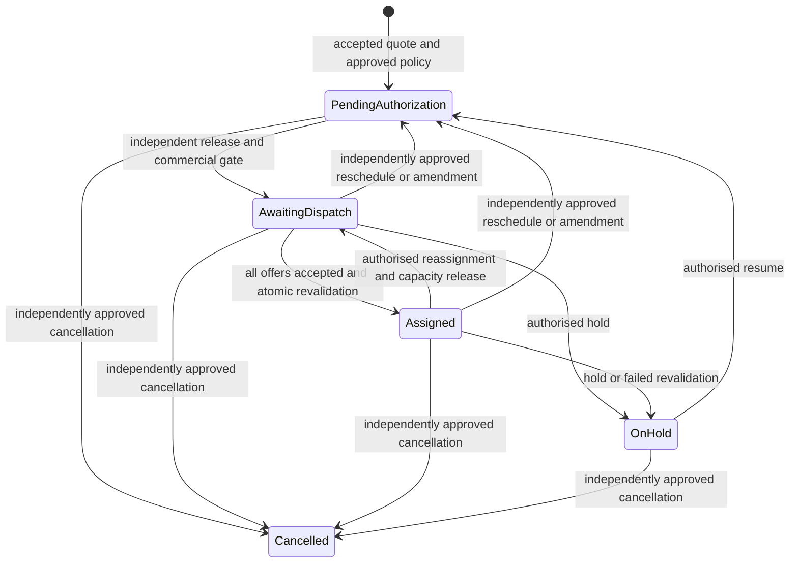

# Increment 4 — service orders, matching and dispatch

> Deployment update (2026-10-27): This increment is now committed, pushed and deployed, with 26 hosted migrations and 126 RLS tables verified. See the [hosted checkpoint report](phase-2-increment-4-hosted-deployment-report.md). Earlier local-only/no-authorisation statements below describe the implementation pass and are superseded by the separately authorised release. Increment 5 was not started.

Date: 2026-10-27, Africa/Lagos. **Implemented and tested locally; not deployed.** No commit, push, hosted migration, real identity, operational configuration, environment change or AWS action was performed. Increment 5 was not started. The unrelated logo remains untouched.

## Baseline verified

Reviewed the master specification's Increment 4 and cross-cutting requirements, all deployed migration groups, quotation/pricing/assessment commands, corporate branches, provider/human capacity, document/Storage controls, audit/outbox, server adapters and local test tooling. Read the installed Next.js data-security guide before adding the server adapter.

Repository remains `main` at `aaef164d530e52be6b293227a46510f8c0b71bb4`, origin `https://github.com/Onitinnovations/Onit`. Read-only CLI inspection verified OnIt project `utoxjlsvqfmmzsjruzsm`, ACTIVE_HEALTHY, PostgreSQL **17.11**, **22 hosted migrations / 115 RLS tables**, matching application definitions against the verified Increment 3 replay. Hosted aggregate counts: zero Auth users, providers, rate cards and provider requirement sets. No hosted data was assumed empty without inspection. [Baseline evidence](phase-2-orders-baseline.json).

The 22 deployed migrations and original reference seed match their prior SHA-256 manifests. They were not modified. Hosted canonical types and the existing browser client remain unchanged.

## Exact new migration inventory

Apply in filename order only after a separate deployment review:

| Migration | Delivered responsibility |
| --- | --- |
| [20261027000100_order_dispatch_foundation.sql](../../supabase/migrations/20261027000100_order_dispatch_foundation.sql) | Ten permission definitions with no automatic role assignments; 11 private order/dispatch tables; typed existing-outbox order relationship; FKs, checks, uniqueness, RLS and append-only records. |
| [20261027000200_order_commands.sql](../../supabase/migrations/20261027000200_order_commands.sql) | Effective independently approved policies; accepted-quote order creation; unique commercial linkage; immutable currency-aware scope; external evidence/credit/exception approval; commercial release; changes, cancellation, holds and rescheduling. |
| [20261027000300_dispatch_commands.sql](../../supabase/migrations/20261027000300_dispatch_commands.sql) | Explainable matching; resource locks and existing capacity reservations; exclusive multi-party offers, responses, override approval, atomic assignment conversion, reassignment, expiry, escalation and revalidation. |
| [20261027000400_order_reads_integrity.sql](../../supabase/migrations/20261027000400_order_reads_integrity.sql) | Scoped projections and keyset discovery; decision/ownership guards; typed worker provenance; service-only idempotent expiry sweep; FK/queue indexes and read models. |

Local candidate: **26 migrations, 126 application tables (51 public / 75 private), all with RLS**. Hosted remains **22 / 115**. No fulfilment, QA, complaint, specialised-service, wallet, payment-gateway or settlement subsystem was introduced.

## New and reused structures

All 11 new tables are in unexposed `private`:

| Tables | Purpose and lifecycle |
| --- | --- |
| `order_policies` | Effective service-version commercial gate, offer deadline and ranking weights. Maker/checker approval, non-overlapping validity, released terms immutable; retire and create successors. |
| `service_orders` | Canonical account/branch/department ownership, source request, service/location/zone, schedule and controlled pre-execution state. Ownership/source retained. |
| `order_commercial_versions` | Unique accepted-quotation links, sequential order commercial versions, exact currency/scale/total and customer-safe quote snapshot. Append-only. |
| `order_authorizations` | Revision-bound, independently decided external payment evidence, order-specific corporate credit or commercial exception; clean same-account document and explicit amount/currency/expiry. Final decisions immutable. |
| `order_changes` | Retained customer/staff reschedule, cancellation or accepted-quote amendment proposal; independent decision and optimistic order revision. |
| `order_history` | Append-only actor/type, reason, permission, correlation, states, revision and order metadata snapshot. System workers have explicit provenance without a fabricated person. |
| `dispatch_candidates` | Append-only provider/personnel, exact demand, approved policy, eligibility reasons and deterministic score snapshot pinned to the order revision. |
| `dispatch_proposals` | One live exclusive assignment bundle per order; expiry, preference override decision and confirmation. Previous bundles retained after reassignment. |
| `assignment_offers` | One addressed contractual-provider offer per bundle, with actual acceptance/rejection actor and timestamp. |
| `assignment_resources` | Immutable exact worker/candidate links to existing provider/human reservation rows. No new capacity store. |
| `dispatch_escalations` | Order-specific operational exceptions and authorised resolution. |

[Generated dictionary](phase-2-increment-4-dictionary.md) enumerates every column, FK, CHECK, unique constraint, index, owner and lifecycle. [Physical FK graph](phase-2-increment-4-erd.md).

Reused: requests and accepted quotations; currency/tax/pricing snapshots; customer accounts, corporate branches and approvers; catalogue versions and verified zones; profiles, organisations and active employment; provider qualifications, coverage, availability, contracts and restrictions; provider pools and global human resources; document registry; audit and idempotency receipts; the single operational outbox and its existing worker.

The outbox gains a typed `order_id`; an event must reference a provider or order. Delivery receipts gain explicit `system_generated` provenance so the expiry worker can record events without inventing an Auth user. Existing delivery creators remain preserved. No second outbox was created.

## Order lifecycle and commercial gates

Orders begin from an accepted, internally approved quotation; corporate creation requires the existing account/branch approver authority, or scoped OnIt order-management permission. The accepted commercial version can belong to only one order. Actor/operation/key receipts, payload equality, quotation advisory locks and unique constraints prevent duplicate confirmation. Changed schedule input cannot silently rewrite an existing order.

Policies must be prepared and independently approved before an order can be created. No real policy, price or timeout was seeded. Gates distinguish `payment_required`, `payment_or_credit` and deliberately approved `no_upfront_payment`. Every release still needs an independent active OnIt employee. Customer parties cannot approve their own commercial release through a second staff role.

Payment evidence is a manual, documented external-evidence workflow: an authorised maker records the external reference, same-account clean registry document, exact amount/currency and validity; a different employee with `orders.payment.verify` decides it. Browser callbacks are never proof. One approved external reference cannot fund unrelated orders; re-verification for another revision of the same order remains possible. This is not collection, reconciliation or a payment ledger.

Corporate status and configured payment days do not confer credit. `orders.credit.approve` independently authorises the evidenced amount and validity for this order/revision. Explicit exceptions use the separate `orders.exception.approve` authority. Gate evaluation rechecks evidence scan state, account/organisation/branch lifecycle, active verified geography, policy validity and the accepted commercial link. Amount precision follows the quotation's snapshotted currency scale. Partial payments, balances and global credit utilisation are outside this phase; the whole quoted amount must be evidenced or independently excepted.

Customer and operations schedule/cancellation requests use retained proposals. Approval requires a different actor and the current revision. Rescheduling withdraws the previous assignment and releases all capacity, returns the order to authorisation and selects the current approved policy. A schedule change does not promise the old provider remains available; redispatch must validate the new window. Holds and resume likewise invalidate the prior release.

Commercial amendments require a newly accepted quotation from the same account, branch, department, service version and equivalent immutable service location. Both accepted links and snapshots survive. Scope/currency/totals cannot be edited in place. All revised work requires a new release and revision-bound evidence where applicable. Cancelled orders cannot be revived. Execution, QA, completion and closure transitions will be introduced by Increment 5; this increment exposes no arbitrary status setter.

## Matching, dispatch and atomic capacity

Staff can submit up to 100 explicit provider/personnel candidates or discover a bounded keyset page using exact approved service/zone coverage and an explicit resource unit/demand. Discovery does not assume city-wide coverage. Each candidate runs the existing eligibility engine: active party/personnel, qualifications/training/verification, evidence, restrictions, contracts, verified coverage, calendars, capacity and configured performance requirements remain mandatory.

Ranking uses explicitly approved performance and workload weights; score/components/reasons are retained. Missing performance is visibly missing and contributes zero, rather than invented history. Stable provider/worker keys break ties. Discovery ranking applies to the evaluated page; it is not a claim of globally optimal matching. No distance, travel time or response-speed measurement is fabricated. Selecting a lower-ranked evaluated candidate requires a reason and independent `dispatch.override.approve`; no override can bypass mandatory eligibility. Selected providers/workers cannot approve their own override.

Each proposal explicitly states resource demand **per executing-person reservation in the contracting party's approved unit**. For example, two workers reserving five kilograms each consume ten party kilograms and two human slots. The backend does not infer kilograms from an unrelated financial quantity. OnIt must scope and enter the correct operational demand.

Canonical allocation order: locked order, service policy lock, sorted global human profile locks (`FOR NO KEY UPDATE`), sorted contracting-provider locks, then reservation rows. These compose Increment 3's existing lock order. Every selected human and party share is reserved in one transaction. A late failure rolls back the entire bundle. No duplicate human is permitted within a bundle. One live proposal per order prevents contradictory exclusive offers.

Each contracting provider receives a separate offer; only its current authorised administrator/individual can accept or reject it. One provider response cannot confirm a multi-provider bundle. Rejection withdraws the whole bundle and releases every resource. Expired or withdrawn responses fail. OnIt confirms only after every offer is accepted, preferences independently approved and the commercial gate remains valid.

Confirmation temporarily excludes this bundle under its canonical resource locks, reruns eligibility for each exact worker/share and converts all reservations to `assigned` atomically. Assigned capacity no longer expires with the offer deadline. The original standalone capacity RPC cannot release dispatch-owned resources. Reassignment, cancellation, hold and rescheduling use dispatch-owned release paths. Revalidation of an assigned bundle either preserves all resources or places the whole order on hold, releases every resource and records an escalation. There is no provider self-assignment.

Logical expiry immediately blocks acceptance and stops reserved capacity consumption. Explicit staff expiry and the service-role-only `expire_dispatch_offers` sweep retain history and emit the same outbox events. The sweep uses bounded `SKIP LOCKED` order batches and is retry-safe; it records a system actor. **No scheduler, live notification sender or background deployment is active.** A future server worker should invoke this RPC with explicit bounded batches and consumer idempotency, then process existing outbox leases; no browser adapter exposes it.

## Server operations, reads and security

[`lib/orders/server.ts`](../../lib/orders/server.ts) exports server-only `orderOperations(accessToken)` with typed create/change/configure/match/discover/dispatch/read-policy/read/list methods. It uses the caller JWT and anon key, verifies Auth `getUser`, maps errors safely and performs no financial arithmetic, credential logging or service-role bypass. No route, screen or browser import was added. Input bounds, exact decimals, identity, scope, current revision and authority are independently validated in PostgreSQL.

Public invoker RPCs: `create_service_order`, `order_command`, `order_policy_command`, `match_order`, `discover_order_candidates`, `dispatch_command`, `read_order`, `read_order_policy`, `list_order_operations`. `expire_dispatch_offers` is service-role-only; it has no user adapter. Helpers are unexposed, pinned-search-path definers with deliberate execution grants.

All new tables have RLS and zero ordinary API table grants; default deny applies even to ordinary staff table clients. No broad authenticated read policy was added. Staff permissions are scoped to current employment/organisation; global configuration approval is separate. Ordinary provider/supplier identities receive no order-management authority.

Customer projections use current account/branch/department access and omit internal decisions, provider candidates and authorisation evidence. Provider projections include only their addressed party/resources; they omit customer account identity, prices, margins, commercial terms and other businesses' offers. Exact service address/scope is available only while actually assigned. Revoked personnel/membership, inactive profiles, reassignment and expiry remove work access. No new general Storage grant or sensitive public bucket was introduced. Evidence uses existing same-account registry/document permissions.

Keyset read views: orders, unassigned queue, pending offers, confirmed assignments, workload/upcoming schedules, expired offers, failed dispatch and unresolved exceptions. Staff history and changes are bounded to 100 rows in a detail projection. Workload is an assignment/resource read model; existing provider eligibility/capacity projections supply peak utilisation and available limits. This is not an unlimited archival export or a whole-company analytics warehouse.

Candidate types: [`database.orders.generated.ts`](../../types/database.orders.generated.ts), generated from the passing native catalog with migration SHA verification. Private schemas are excluded. Hosted canonical types remain at the deployed 22-migration baseline. Compile-only negative contracts reject private schema access, arbitrary status changes, numeric capacity input, customer provider selection and payment callbacks.

## Executed validation

Machine evidence: [full test results](phase-2-orders-test-results.json), [26-migration manifest](phase-2-orders-candidate.sha256), [local query plans](phase-2-order-query-plans.json).

| Check | Actual result |
| --- | --- |
| Fresh PostgreSQL 17.11 replay | All 26 migrations applied to a new disposable loopback database; original safe seed replayed twice. |
| Previous SQL regression suites | All 363 assertions passed. |
| Increment 4 SQL | 55 assertions passed in [007_orders_dispatch.sql](../../supabase/tests/007_orders_dispatch.sql); **418 primary SQL assertions total**. |
| Separate-connection concurrency | Existing 4 request/quotation and 7 provider/personnel checks plus **11 new order checks passed**, using 53 connections overall. |
| New race/failure coverage | Duplicate creation/receipt conflict; competing businesses reserving the same two-person team; late multi-person failure; one response and one assignment winner; reassignment release; stale responses; real 31-second expiry; system expiry denial/retry/provenance; provider rejection. |
| Upgrade preservation | Six earlier accepted-quotation checks plus four Increment 3 upgrade checks passed. Six provider/resource/history/outbox tables retained their original row digests and a live shared-human reservation still blocked another business after upgrade. |
| Catalog security | 126 RLS tables; private schema denial, safe definer paths, no PUBLIC internal execution, no anonymous provider execution, protected worker/expiry execution and no client transaction writes. |
| Types/application | Candidate types regenerated; TypeScript and ESLint completed successfully. |
| Dependencies | npm audit returned zero vulnerabilities; dependencies/lockfile unchanged. |
| Plans | Five actual local EXPLAIN ANALYZE/BUFFERS plans inspected; small synthetic fixtures, not production-scale benchmarks. |

Commands: `node scripts/database/check-orders-baseline.mjs` (read-only hosted), `npm run db:test:orders`, `npm run db:types:orders`, `node scripts/database/order-query-plans.mjs`, `node node_modules/typescript/bin/tsc --noEmit`, `node node_modules/eslint/bin/eslint.js .`, `npm.cmd audit --json`, artifact scan and `git diff --check`.

Normal SQL files roll back. The native runner retains labelled synthetic fixtures only in the newly created disposable database for multi-connection races. Fresh and upgrade rehearsals never target hosted data. The historical Increment 3 runner is bounded to its original 22 migrations/six suites so the deployed baseline remains reproducible.

Development failures were corrected before passing full reruns: a test document had two owners; form answers omitted the required versioned group; a fixture confused a customer address with an immutable service-location snapshot. Native PostgreSQL also needed crash-recovery time after a restart; the new runner waits for a successful SQL probe. No failing run is counted as passed.

Not executed: real candidate Auth JWT/REST/Storage workflows or server-adapter HTTP integration, full Supabase Docker runtime, production-volume benchmarks, hosted dry run or candidate deployment. Native SQL role simulations do not replace those tests. No approved hosted test identities were created or used. The local migration owner is superuser; managed hosted DDL still needs review.

## Review and deployment readiness

Increment 4's local backend checkpoint is ready for code/GitHub review. **No push or hosted deployment is authorised in this implementation pass.** Before any hosted rollout: separately approve the exact four migrations, refresh drift/history checks, create and restore-test a fresh external backup, complete approved Auth/API/Storage integration testing, review `db push --dry-run` for exactly these four files, inspect operational grants and generate canonical types only after approved deployment. Do not run historical release scripts blindly against 26 files.

Existing live data, keys, project link, hosted types, seed and deployed SQL remain untouched. No real policy, credit authorisation, evidence, provider, assignment or commercial rate was activated. Real operations need approved policies/eligibility/capacity and deliberate staff role grants. Performance observations are still the existing evidenced/configured metrics; no historical acceptance/QA scores or travel measurements were fabricated.

Recovery remains forward-fix: pause affected callers, inspect rolled-back command/audit evidence, retain commercial/assignment history and release resources through authorised commands. Never reset or destructively roll back a real database. An eventual backup must cover the shared outbox creator/provenance changes as well as new tables; Storage object bytes and managed-platform recovery require separate coverage.

Increment 5 may build work orders/tasks, execution states, evidence, supervision, QA, rework and closure on confirmed bundles and exact commercial/resource IDs. Those modules were not started. **Stop here for Increment 4 checkpoint review.**

## Changed-file map

- Four additive migrations listed above and the new 007 order/dispatch SQL suite.
- New server adapter, candidate types and negative compile-time contracts under lib/orders, types and scripts/database.
- New native order runner, read-only baseline inspector, order concurrency and provider-upgrade rehearsals, type/dictionary generation and query-plan inspection. The historical provider runner now has a migration/test cutoff; no deployed migration or seed changed.
- New report, 11-table/two-reused-table dictionary, FK graph, sanitised baseline/test/plan evidence and candidate hash manifest. Root plan, navigation, inventory, ERD and continuation banners updated. Package scripts add db:test:orders and db:types:orders; no dependencies or lockfile changes.
