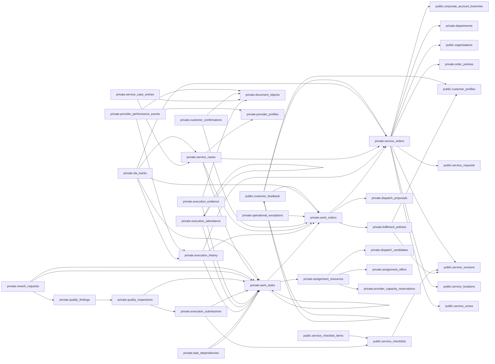

# Service Fulfilment — physical FK graph

Local candidate. Actor/creator references are documented in the dictionary but omitted from this graph. Existing provider, human resource, quotation and customer references are reused.

