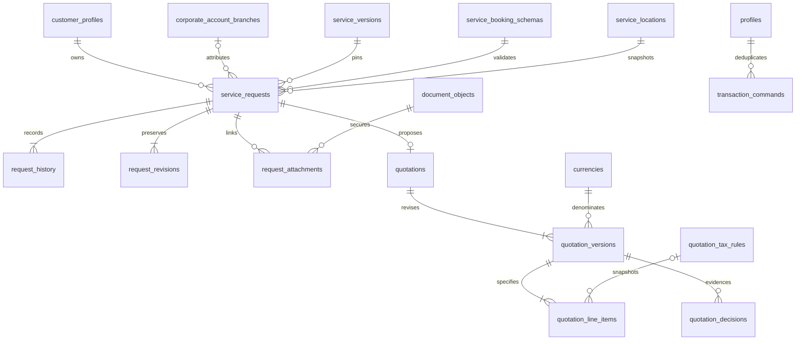

# Phase 2 request/quotation increment — schema and security dictionary

Current extension: [Increment 2 schema and ERD](phase-2-increment-2-schema.md) adds four private tables, extends pricing/policies and makes quotation precision currency-aware. The definitions below are the Increment 1 baseline; its two-decimal-only limitation is superseded locally.

This describes actual local migrations 20261025000100 and 20261025000200. It does not describe hosted additions. Phase 1 objects are reused unchanged except for the additive migration's replacement of the Storage read helper to include exact linked-branch evidence access.

| Table | Purpose / key fields | FKs / uniqueness / indexes | Owner, policy and lifecycle |
| --- | --- | --- | --- |
| `public.service_requests` | Customer intent; UUID id/reference; customer/organisation/branch/department, exact service/version/schema, snapshot location, status/revision, answers JSON, preference window and instructions. | Customer, org, exact composite branch/account/org and department/org; service/version/schema consistency; location/account composite; actor profile. Reference unique. Account/time/id, branch/time, queue/status, version/schema/location and other FK indexes. | Customer account and scoped request staff. Authenticated SELECT only through request_access. Writes via RPC. Draft/submitted/reviewed/cancelled; created/updated/actor metadata; no hard delete/truncate. Accepted commercial scope cannot use simple request cancellation. |
| `public.request_history` | Safe customer progress evidence: request, revision, action, actor/time. No raw answer or private staff note payload. | Request and actor FKs; request/revision unique and indexed. | Same read boundary as request. Append-only, including TRUNCATE guard. Full snapshots are separate private records. |
| `private.request_revisions` | Historical full request snapshot per revision. | Request and creator FKs, request/revision unique. | Operational retention/audit owner. No browser grants/policies. Append-only. Contains private customer data; future retention workflow must cover it. |
| `private.transaction_commands` | Actor-scoped critical-write idempotency receipt; command, key, canonical JSON payload, resulting UUID. | Actor FK; actor/command/key unique. Result is a typed-by-command reference because it can identify either request or quote, not an independently editable business entity. | No browser grants/policies. Append-only. Sensitive payload private; do not export logs. Scoped hash lock is only serialization; the unique key remains the invariant. |
| `public.request_attachments` | Exact request-to-registry document association. No binary content or public URL. | Request/account and document/account composite FKs, creator FK; request/document unique; document FK index. | Request readers see linkage. Command requires request write access, draft state and clean same-account customer document. Append-only/idempotent; Storage still checks scan state, active ownership and branch linkage. |
| `private.quotation_tax_rules` | Immutable named/versioned country tax configuration: percentage, effective window, status. No production rate seed. | Country/creator FKs; code/version unique; FK indexes. | Privileged configuration owner only, no browser access or client command. Append-only, including UPDATE/DELETE/TRUNCATE. New rules get new versions; quote lines snapshot selected label/rate. |
| `public.quotations` | Stable request-to-proposal identity and reference. | Request/creator FKs; one identity per request; unique reference. | Read only if an accessible version exists. Immutable identity; customer cannot see draft-only identity through policy. |
| `public.quotation_versions` | Exact request revision/currency/pricing mode/terms/validity, totals, maker/approver/customer decision metadata. | Quotation/currency/creator/approver/decision actor FKs; quotation/version unique; one draft/offered/accepted revision per identity via partial unique index; expiry and FK indexes. | Draft visible only to scoped quote managers/approvers. Released/final proposals visible through request-read scope. Commands require trusted employment permissions or customer approval rights; maker cannot approve. Accepted/rejected/expired/superseded rows immutable. Draft content changes require new version; no delete/truncate. |
| `public.quotation_line_items` | Customer-facing service/labour/materials/logistics/other specification, quantity/unit price/discount, tax config snapshot and exact line totals. | Version/tax rule/creator FKs; version/position unique; FK indexes. Numeric CHECKs enforce gross, discount bound, tax rounding and total identities. Currency inherited from exact parent version. | Same policy as version. Append-only including TRUNCATE. No provider cost/margin columns. Decimal-string RPC is preferred over raw numeric JSON. |
| `private.quotation_decisions` | Typed independent approval/customer decision/supersession/expiry evidence. | Quote version and creator FKs; version/decision unique. | Private, append-only, no client access. Shared Phase 1 audit receives action/subject metadata without raw commercial payloads. |

All ten tables have RLS. Public tables grant authenticated SELECT only; no anonymous table grants and no unrestricted authenticated read policies. Private tables have no client policies or schema USAGE. Migration owner/service-role are privileged infrastructure; no service-role key or bypass client is added. Supabase Auth remains the identity authority.

## Command boundaries

| Public invoker RPC | Security-definer implementation checks |
| --- | --- |
| `create_service_request` | Active caller/account or exact branch requester and department; current published service/schema; active same-account address; version FKs; validated preference window; idempotency key/payload. Copies address into Phase 1 service_locations. Incomplete drafts permitted. |
| `change_service_request` | Current request write access, locked expected revision; draft-only amend/submit; bounded server-side answer validation on submission; customer cancellation of pre-accepted scope only. |
| `review_service_request` | Active employed staff with scoped requests.review; submitted state and expected revision. |
| `attach_request_document` | Exact request write scope, draft, same-account clean non-archived customer document. |
| `prepare_quotation` | Active employed staff with scoped quotes.manage; request row lock/reviewed state; actor/key serialization; valid future window; explicit matching currency; bounded decimal-string lines; selected effective country tax configuration; revision without accepted-scope overwrite. |
| `decide_quotation` | Consistent request-first lock ordering. Independent scoped staff approval of current draft; customer/branch approver acceptance/rejection of unexpired offered quote matching current reviewed request; scoped manager expiry. |
| `read_quotation` | Version read policy equivalent; returns exact monetary strings, not private cost data. |

Definers are unexposed `app_private` functions with pinned empty search paths. Public wrappers use invoker rights. Only required commands and safe boolean helpers grant EXECUTE to authenticated; internal validator, event writer and arithmetic helpers retain revoked PUBLIC execution. New permission definitions have no automatic role assignments. A reviewed RBAC grant is necessary before staff use these workflows.

## Answer envelope and validation

Example only: `{"details":[{"bedrooms":3,"property":"flat","parking":false}]}`. Keys are versioned group/field keys, not arbitrary JSON configuration. Every supplied group must exist; occurrences must respect min/max and repeatable constraints. Unknown/hidden fields fail. Requiredness and same-schema typed dependencies are checked; AND within a condition group, OR across groups. A repeated source in a different group is rejected as ambiguous; support requires an explicit future cross-group binding design. Optional absent values may be JSON null.

Text, exact JSON numbers, booleans, ISO dates, configured single/multiple choices, clean owned document references and bounded length/numeric/choice/file-size rules are implemented. No SQL, JavaScript expressions or regular expressions from customer answers are executed. Date/choice/document validation occurs in the database, not just the adapter. Published schemas stay pinned and immutable through Phase 1 guards. Raw snapshots remain private.

## Implemented ERD

Order/provider/dispatch/fulfilment entities are absent intentionally in this increment; no diagram relationship implies those features have been implemented.
